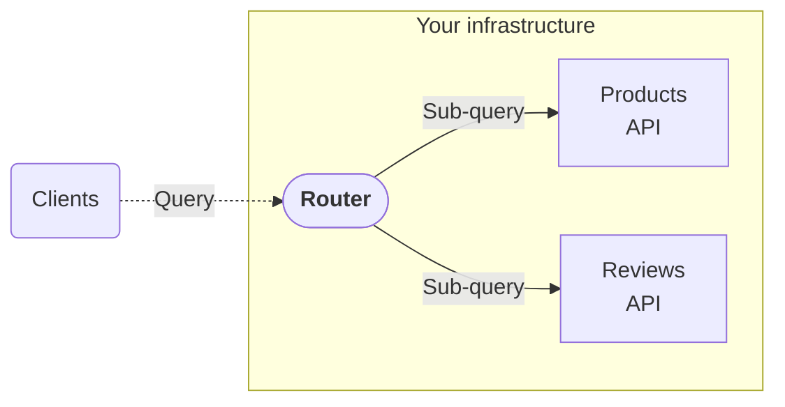

Apollo Router is a graph runtime that you can deploy in your own infrastructure.



For each version of the Apollo Router, Apollo provides:

- [A Helm chart for Kubernetes](#kubernetes-using-helm)
- [A Docker image](#container)
- [A binary](#local-binary)

<Note>

For a more detailed look at production deployment workflows for the full supergraph architecture, including blue-green and canary deployments, see [Deployment Best Practices](/graphos/platform/production-readiness/deployment-best-practices).

</Note>

<Note>

If your organization uses a transparent or egress proxy (such as Zscaler or Netskope), [add your proxy's root CA certificate to your container image](/graphos/routing/self-hosted/containerization/proxy-certificates). Without it, the router can't establish TLS connections to Apollo Uplink, resulting in certificate validation errors or "invalid license" failures.

</Note>

## Kubernetes

### Apollo GraphOS Operator

Apollo recommends the [Apollo GraphOS Operator](/apollo-operator/). The Operator provides declarative Kubernetes resources to manage routers, supergraphs, graph schemas, and subgraphs. It simplifies complex multi-service architectures.

The Operator supports [workflow patterns](/apollo-operator/workflows/) based on your infrastructure:
- Single-cluster setups for simpler deployments
- Multi-cluster and hybrid configurations for distributed services
- Deploy-only patterns for existing CI/CD workflows

### Helm

Helm is a package manager for Kubernetes. Apollo provides a Helm chart with each release of Apollo Router in the GitHub Container Registry. Since router v0.14.0, Apollo has released each router Helm chart as an Open Container Initiative (OCI) image in `oci://ghcr.io/apollographql/helm-charts/router`.

Follow our [Kubernetes quickstart](/graphos/routing/self-hosted/containerization/kubernetes/quickstart) to deploy the router with a Helm chart.

## Docker

### Apollo Runtime Container (Recommended)

Apollo provides the [Apollo Runtime Container](https://github.com/apollographql/apollo-runtime), which bundles all that's required to run the Apollo Runtime in one place. This includes the Apollo Router and the [Apollo MCP Server](/apollo-mcp-server).

You can download the images from:

- [Docker Hub](https://hub.docker.com/r/apollograph/apollo-runtime) (recommended)
- [GitHub Container Registry](https://github.com/apollographql/apollo-runtime/pkgs/container/apollo-runtime)

For more information on deploying using your container environment:

- [Docker](/graphos/routing/self-hosted/containerization/docker)

### Router only container

This image is recommended only for Kubernetes-based deployments, and is used by the [Helm chart](/router/containerization/kubernetes/). For more information on deploying using your container environment:

- [Docker](/graphos/routing/self-hosted/containerization/docker-router-only)
- [AWS using Elastic Container Service (ECS)](/graphos/routing/self-hosted/containerization/aws)
- [Azure using Azure Container App](/graphos/routing/self-hosted/containerization/azure)
- [GCP using Google Cloud Run](/graphos/routing/self-hosted/containerization/gcp)

## Local binary

Running the Apollo Router directly from its binary speeds up local development and enables embedded use cases where containers are unavailable. 

Follow the [quickstart](/graphos/routing/get-started) to run a router binary.

## Troubleshooting

### Certificate validation errors or "invalid license" failures

**Symptom:** The router logs show `certificate verify failed` or `invalid license` errors at startup, or the router repeatedly fails to fetch the supergraph schema.

**Cause:** A transparent or egress proxy (such as Zscaler or Netskope) is intercepting TLS connections between the router and Apollo Uplink. The router rejects the proxy's certificate because it's not in its trust store.

**Resolution:** Add your proxy's root CA certificate to your container image. See [HTTP proxy configuration](/graphos/routing/self-hosted/containerization/proxy-certificates) for step-by-step instructions.

### OOMKilled pods

**Symptom:** Kubernetes terminates the router pod with an `OOMKilled` exit reason. Running `kubectl describe pod <pod-name>` shows `Reason: OOMKilled` and the pod restarts repeatedly.

**Cause:** The router's memory limit is too low for the traffic volume or operation complexity it's handling.

**Resolution:** Start with a memory limit of `2G` and no CPU limit, then tune based on observed usage. See [Managing router resources in Kubernetes](/graphos/routing/self-hosted/resource-management) for recommended starting values and guidance on setting horizontal pod autoscaling targets.

### Health check failures

**Symptom:** The router pod is running but the load balancer or Kubernetes liveness probe marks it unhealthy, causing the pod to be removed from rotation or restarted.

**Cause:** The load balancer or probe is hitting the wrong port or path. By default, the router's health check endpoint listens on port `8088` at `/health`. If your infrastructure expects a different port or path, the check will fail even when the router is healthy.

**Resolution:** Verify the router is reachable at `http://<router-host>:8088/health`. If you need a different port or path, configure `health_check` in your `router.yaml`:

```yaml title="router.yaml"
health_check:
  listen: 127.0.0.1:8090
  path: /healthz
```

See [Health checks](/graphos/routing/self-hosted/health-checks) for full configuration options and how to test the endpoint with `curl`.
